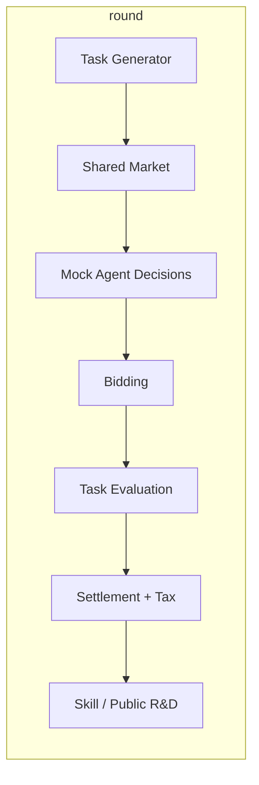

# Architecture — AI Civilization MVP

## 设计原则

1. **Simulation Engine 不依赖 UI 与 LLM** — 可在 Node CLI / Vitest 中独立运行。
2. **Agent 只提交结构化决策** — 引擎校验并改状态；LLM 永远不能写钱包或能力值。
3. **所有财富变化可记账** — 任务报酬来自「世界任务市场」注入；Skill 购买为 sink；税收进入文明国库与公共研发池。
4. **同 seed 可复现** — Mulberry32 + 确定性 Mock 决策，便于制度对照实验。

## Monorepo 布局

```
packages/simulation   ← 核心（已完成 v0 闭环）
packages/server       ← HTTP + SQLite 持久化（planned）
packages/web          ← React + Vite + PixiJS + Tailwind（planned）
```

## Simulation 模块

| 模块 | 职责 |
|------|------|
| `core/types` | 文明、Agent、任务、制度、事件、配置 |
| `core/factory` | 双文明初始状态、自由市场 vs 公共研发默认制度 |
| `core/engine` | 按轮推进：发任务 → 竞标 → 执行 → 结算 → 投资 |
| `core/skills` | Skill 目录与有效能力计算 |
| `market/*` | 任务生成、竞标评分 |
| `economy/*` | 税收、工资、Skill 购买、公共研发 |
| `evaluation/*` | 规则化任务成功率（未来可换 LLM 验收） |
| `agents/*` | `AgentDecisionProvider`；默认 `MockAgentDecisionProvider` |

## Agent 决策接口（扩展点）

```typescript
interface AgentDecisionProvider {
  decideForCivilization(ctx): AgentDecision[]; // 每 Agent 一条
}
```

后续增加 `OpenAICompatibleAgentProvider`：仅输出 `bid` / `buy_skill` / `collaborate` 等 JSON，由 engine 校验。

## 数据流（单轮）



## 技术栈（与交接文档对齐）

| 层 | 选型 | 阶段 |
|----|------|------|
| 模拟 | TypeScript 纯逻辑 | **Now** |
| 测试 | Vitest | **Now** |
| API | Fastify | Phase 4 |
| DB | SQLite | Phase 4 |
| UI | React + Vite + Tailwind + PixiJS 8 | Phase 5+ |

## 刻意未引入

Unity、Redis、K8s、微服务、在线多人 — MVP 验证玩法后再加。
