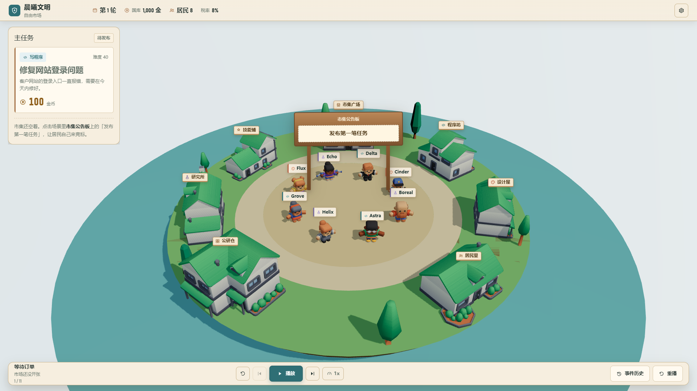
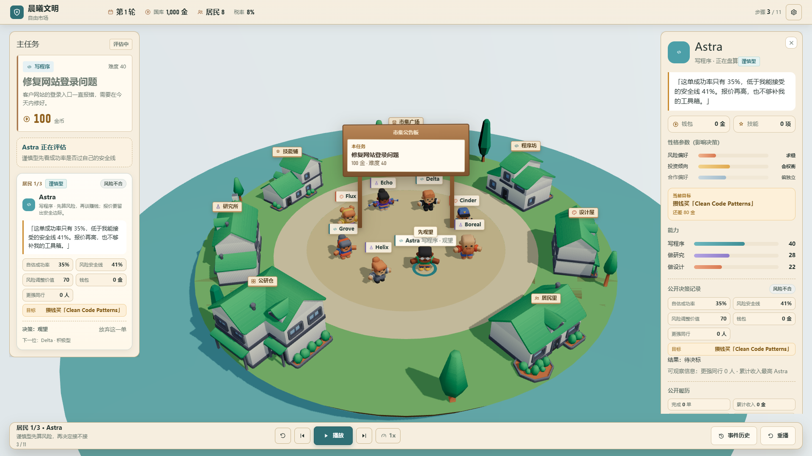
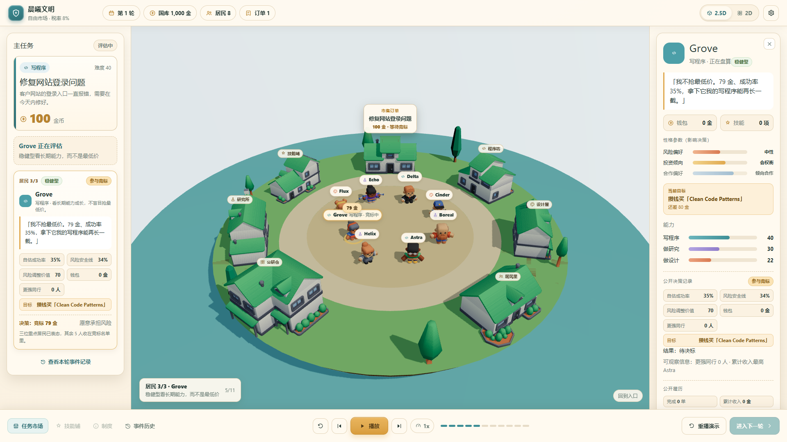

# Agent 角色博弈 + 经济剧场 — 验收材料（2026-11-07 · v2 / v3 设计升级）

> 分支：`feat/visual-cozy-hud` · PR #2 · 演示路由：`/game`
> 证据：`docs/screenshots/game-hud/`（1920 与 1366）、`docs/recordings/game-bid-demo-1280x720.mp4`
>
> **v3 设计升级（world-first HUD）**：按 `frontend-design` 技能完成设计计划与渲染复盘 —
> 全幅 3D 世界 + 浮动任务纸板 + 按需居民档案 + 单行播放坞；市集公告板成为唯一发布入口与中标/结算印章。
> 计划见 `docs/DESIGN_PLAN_GAME_HUD_V3.md`，渲染复盘与评分见 `docs/DESIGN_REVIEW_GAME_HUD_V3.md`。
> 本文件保留 v2 的功能与数值说明；截图已替换为 v3。

---

## 1. 本轮目标（对应指令校准）

上一版竞标只有「3 人报价、5 人观望、Delta 中标」，角色更像数字。本轮把研发重点放在：

1. **竞标变成一场可观察的经济博弈**：每个重点 Agent 的动机、风险判断、钱包目标、对同行的公开认知、报价理由、落标反思，都能按步骤看到。
2. **Agent Character Profile**：职业、性格、风险/投资/合作偏好、钱包、能力、Skill、当前目标、公开履历、本轮决策记录。
3. **性格真正影响经济决策**（不是文案标签）：`riskTolerance` 决定「风险安全线」与报价边际；`domainAffinity` 影响任务价值；`investAggression` 影响是否买 Skill。
4. **三层接口**：Decision Layer（引擎）→ Explanation Layer（结构化解释）→ Presentation Layer（玩家对白）。对白只解释已发生的决策，绝不改写报价/结算。
5. **游戏化 HUD 继续升级**：重点居民卡、竞标名单、公开履历、Goal、性格参数、2D/2.5D 对照。

---

## 2. 三层架构落地位置

| 层 | 位置 | 内容 |
|----|------|------|
| Decision | `packages/simulation/src/agents/mock-decision-provider.ts`、`market/bidding.ts`、`core/odds.ts` | 性格参与决策：安全线、报价因子、任务价值、是否参与 |
| Decision → 事件 | `core/engine.ts` / `core/engine-async.ts` | `bid_placed` 增加结构化字段；新增 `bid_declined` 事件（reasonCode + factors） |
| Explanation | `scripts/gen-bid-demo.mjs` | 把事件 payload 转成 `decision` 结构（成功率、安全线、价值、目标、可观察同行、结果） |
| Presentation | `packages/web/src/game/presentation.ts` | 把结构化因子变成短对白/反应；不触达任何经济数值 |
| UI | `packages/web/src/game/GameHud.tsx` / `GamePage.tsx` | 十步演出、重点居民卡、人物档案、2D 对照 |

**反作弊约束：**
- 报价、任务结果、金币、Skill 全部来自 fixture / 引擎，前端只读。
- 对白中的每个数字都来自 `decision.reasonFactors` / `decision.*`，不凭空生成动机。
- Agent 只知道公开信息：`observedCompetitors` 仅由公开履历（更强同行人数、累计收入最高者）计算，不读取其他 Agent 的当前报价。
- 未观察到的信息不解释。

---

## 3. 十二步竞标剧场（实际 10 步主流程 + 2 个演出状态）

| # | 步骤 | 玩家看到什么 |
|---|------|--------------|
| 0 | 订单公告 | 市集挂出 100 金 Coding 单，8 位居民开始评估 |
| 1 | 重点居民 1/3 · Astra | 谨慎型：自估成功率 35% < 自己的安全线 41% → 放弃；显示安全线/目标/同行信息 |
| 2 | 重点居民 2/3 · Delta | 积极型：差 80 金买 Skill，报价 71 金抢单 |
| 3 | 重点居民 3/3 · Grove | 稳健型：不抢最低价，报价 79 金，看长期能力 |
| 4 | 公开报价 | 2 人竞标、6 人观望；每个人的理由都可点开查看 |
| 5 | 决标 | 系统按「质量预测 × 报价」选 Delta（同质量、低价） |
| 6 | 反应 | 赢家「拿下了！」，落标者复盘自己的报价 |
| 7 | 执行 | 中标者走向程序坊 |
| 8 | 结算 | 100 金 − 8 税 = 92 金到手，国库 +7 |
| 9 | 投资 Skill | 花 80 金买 Clean Code Patterns，写程序 40 → 48 |
| 10 | 下一轮反馈 | 同难度任务成功率 35% → 55% |

命令：`npm run dev` → http://127.0.0.1:5173/game

---

## 4. 性格 → 决策的公式（可核对，不是文案）

| 参数 | 作用 |
|------|------|
| `riskTolerance` | `风险安全线 = 0.20 + (1 − riskTolerance) × 0.28`；自估成功率低于安全线 → `bid_declined`（reasonCode `risk_above_comfort`） |
| `riskTolerance`（报价） | `价格因子 = 0.72 + rng×0.18 + (0.5 − riskTolerance)×0.10 − 攒钱紧迫 0.035`；谨慎者保留更高边际，冒险者/攒钱者报更低 |
| `domainAffinity` | `风险调整价值 = expectedQuality × reward × (1 + affinity)`；低于 25 → 放弃 |
| `investAggression` | 结算后是否购买 Skill（引擎既有逻辑） |
| `cooperationPreference` | 本轮只展示、不参与决策（明确标注「未来多人机制」） |

本轮实测（fixture `seed=20`）：

- Astra：risk 0.25 → 安全线 41% > 成功率 35% → **放弃**（若报价再高也不接）
- Delta：risk 0.70 → 安全线 28% > 35% → **竞标 71 金**（低价抢单）
- Grove：risk 0.50 → 安全线 34% < 35% → **竞标 79 金**（不抢最低价）
- 其余 5 人：自估成功率 5%–12%，全部低于个人安全线 → 观望（不是随机放弃）

---

## 5. 证据

### 完整主界面（1920×1080）

### 重点居民决策（3 张）

### 竞标 / 决标 / 结算 / Skill / 2D 对照

- `06-bids-1920x1080.png`（2 人报价 + 6 人观望）
- `07-assigned-1920x1080.png`（赢家 + 落标复盘）
- `09-settled-1920x1080.png`（奖励 / 税 / 到手）
- `10-skill-1920x1080.png`（买 Skill，能力 40→48）
- `12-2d-debug-1920x1080.png`（同一段竞标的 2D 信息板，仅开发面板内可切换）
- `map-only-1920x1080.png`（隐藏 HUD 的仅地图诊断图）
- `failure-glb-blocked-1920x1080.png`（GLB 阻断时的可见失败态 + 重试）
- 1366×768 全套：`docs/screenshots/game-hud/1366/`

### 录屏

`docs/recordings/game-bid-demo-1280x720.mp4`（约 29 秒，真实 Edge + WebGL；软件渲染环境约 4–6fps，用于核对顺序，不代表最终性能）。

### 真实事件与数值

- 数据文件：`packages/web/src/demo/bid-demo.fixture.json`（`rawEvents` 含 `task_posted / bid_placed / bid_declined / task_assigned / task_completed / tax_collected / skill_purchased`）
- 关键数值：奖励 100 → 税 8 → 到手 92；Delta 钱包 0 → 92 → 买 Skill 80 → 12；写程序 40 → 48；同难度成功率 35% → 55%
- 生成命令：`npm run demo:fixture`（要求先 `npm run build -w @ai-civ/simulation`）

---

## 6. 2.5D vs 2D（更新判断）

- 2.5D：空间关系、走动、聚拢/去工坊让「文明」有生命感；适合作为主舞台。
- 2D 板：一屏可读完「焦点三人的性格/决策、投标席、观望席、结算」，适合信息密度高的竞标环节。
- **建议：2.5D 主场景 + 2D 竞标覆盖层**，而不是二选一；请负责人实机体验后拍板。

---

## 7. 构建 / 测试 / 浏览器自测

| 检查 | 结果 |
|------|------|
| `npm test`（simulation，含新增 4 个决策测试） | **11/11 通过** |
| `npm run build -w @ai-civ/web` | 通过（≈1.45 MB JS，>500 kB 警告未处理） |
| `/game` 浏览器自测 | 10 步单步走通；重点居民自动聚焦；2D/2.5D 切换正常；事件抽屉与 Debug 面板可用 |
| 控制台 | 仅 favicon 404；3D↔2D 切换有非阻断 React 警告 |

---

## 8. 仍未完成 / 不满意

1. 仍使用 fixture 回放，未接真实 `advance` 事件流（下一阶段 Event Playback）。
2. 观测对手只用了公开履历，尚未做「同行报价可见性」的制度化设计（当前默认不公开实时报价）。
3. 动画只有 Idle/Walk + 直线位移，无寻路；工作动作未单独制作。
4. 3D↔2D 切换有 React 警告；1280×720 左栏需要滚动。
5. 5 位简化角色只有一段模板对白，未做完整人物弧光。
6. 未接入真实 LLM；对白为模板，零付费调用。

---

## 9. 建议下一轮三个优先

1. **真实 Event Playback 接线**：`/game` 从 API 创建/推进文明，按真实 `events` 播放；补「跳过动画不改变 GameState」契约测试。
2. **制度实验接线**：把税率 / 公共研发 / Skill 私有-共享接入 HUD，让同一批角色在不同制度下重新竞标，形成可观察差异。
3. **角色弧光**：给三名重点角色加入跨轮记忆（最近一次中标/落标/买 Skill），对白引用真实历史；仍不引入付费 LLM。

---

## 10. 三层验收自检（不等于通过）

- **技术验收：** 构建通过、simulation 11/11 测试通过；事件与数值可由 fixture 核对。
- **视觉验收：** 游戏化 HUD、重点居民卡、人物档案、2D 对照均已完成；仍需负责人判断「像不像成熟策略游戏」。
- **体验验收：** 新玩家能看到「三种性格 → 三种决策 → 竞价 → 中标 → 赚钱 → 投资 → 下轮变化」；制度影响尚未验证。

> 请项目负责人实机试玩后决定：是否进入真实 API Playback，以及 2.5D/2D 的最终取舍。未经确认不会合并 PR。

---

## 11. 2026-11-08 Mac 接手增量：制度实验台

- 顶栏「制度实验」：税率 / 公共研发 / 技能归属 / 种子 → 调用真实引擎重跑一回合。
- 高税 35% 时 Delta 税后 65 金，买不起 80 金技能，能力停在 40；竞价本身不变。
- 详见：[`INSTITUTION_LAB.md`](INSTITUTION_LAB.md)；接手复核：[`MAC_TAKEOVER_2026-11-08.md`](MAC_TAKEOVER_2026-11-08.md)。
- 测试由 11/11 增至 **29/29**；新增国库/税金拆解、制度实验台、右侧档案信息节奏、7 栋建筑功能剪影、5 轮文明（含落盘恢复）、Event Playback cue-by-cue 、建筑状态绑定、2.5D 视觉升级、文明编年史与 `/api/games` demo 适配。`/game` 默认仍可离线播放。
