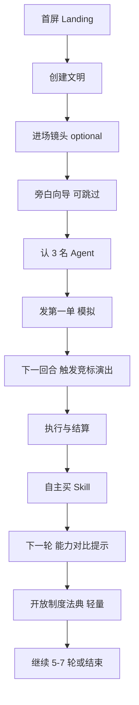

# Vertical Slice — 新手与经济闭环 UX

> 单文明 · 8 Agent · 5–7 轮 · Deterministic Mock · `/play-3d`  
> 对照交接文档第十～十四节与 `DECISIONS.md`

---

## 屏幕流（MVP）

---

## 1. 首屏 Landing（`/` 或重定向）

**看到什么：** 缓慢活动的微缩文明背景（Walking Skeleton 后实装）；暖色天空。

**文案：**

- 标题：**AI Market Game**
- 副标题：*Build a civilization. Let AI evolve.*
- 说明：欢迎来到 AI 也要上班、攒钱、卷 Skill 的世界。

**按钮：**

| 按钮 | 行为 |
|------|------|
| 创建我的文明 | → 创建流 |
| 观看演示 | → seed 固定 replay（引擎事件，非视频） |
| 规则说明 | → 轻量帮助抽屉 |

---

## 2. 创建文明

**输入：** 文明名称（默认随机趣味名）  
**选择：** 自由市场 / 公共研发 / 混合经济（映射现有 `CivilizationRules`）  
**不出现：** 数十参数、旗帜编辑器（P2）

**旁白：** 你是制度设计师，不是每个 AI 的老板。

**完成：** < 1 分钟 → `POST /games`（后续可单文明 payload）

---

## 3. 进场（`/play-3d`）

**HUD 顶栏：** 文明名 · 总金币 · 轮次 · 人口 8 · 生产力指数  
**HUD 底栏：** 暂停 · 下一轮 · 自动 · 速度 · 发任务 · 制度 · Skill 市场  
**左右：** 可收起 — 左：任务/事件；右：选中详情  
**中央：** 3D 沙盘 ≥ 60% 视口

**向导（逐步聚焦，可跳过）：**

每步高亮建筑/概念：Agent → 任务 → 金币 → Skill → 制度

---

## 4. 认三名 Agent（Alpha / Beta / Gamma）

地图点击或列表面板；展示能力、钱包、个性文案（与 traits 一致）、当前 Skill。  
**个性必须来自数据**，非纯虚构。

---

## 5. 玩家发第一单

点击 **任务市场** → 预设「个人网站」→ Coding · 奖励 100（从 **marketEscrow**）  
动画：任务卡飞向市场；气泡：「新活儿来了！」  
**标签：** 模拟任务（非真实交付）

---

## 6. 下一回合 — 竞标剧场（核心）

**禁止：** 按钮一点直接「Alpha 获得 100 金币」。

**顺序（L2 面板 + L1 气泡 + 3D 走位）：**

1. 市场高亮，订单展示  
2. Alpha：参与 · 报价 70 · reason_summary  
3. Beta：放弃 · reason_summary  
4. Gamma：报价/合作意向 · reason_summary  
5. 决标解释（质量/风险/报价综合）  
6. Alpha 中标 → 走向 Coding 工坊  
7. 进度：分析→工作→验收（引擎成败）  
8. 钱包 + 税收 HUD  
9. Alpha 投资决策（三选一 + reason_summary）  
10. Skill 商店动画 · 能力 75→88  
11. 下轮新单：**预测成功率前后对比**（标明模拟预测）

**Playback：** 全部可暂停/单步/加速/跳过；跳过不改变 `GameState`。

---

## 7. 制度（第一轮闭环后）

法典风面板：税率 · 公共研发 · Skill 私有/共享（现有 rules 子集）  
改完 → 下一轮观察到手收入与投资变化

---

## 8. 演示模式（观看演示）

- 固定 `seed` + 录制的事件序列 JSON（从真实 `sim:dual` 或单文明 run 导出）  
- 同一 Playback Controller，只读不写 API  
- 明确「演示」水印

---

## 9. 与 `/classic` 关系

研究向 2D 双文明界面保留；默认入口待 P0 验收后改为 `/play-3d`。
